# Juvo — Feature Guide

The multi-store marketplace

> This guide is generated automatically on every merge: CI builds the
> app, walks the guided tour on an Android emulator, and captures
> each screen below.

## 1. Welcome to Juvo

Juvo is every store in one app - sign in to get started.

## 2. Sign in

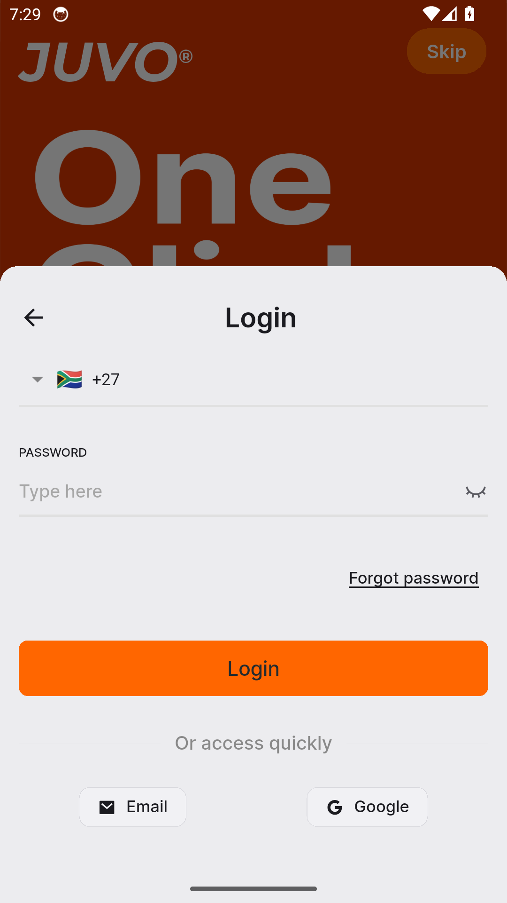

Signing in to Juvo is quick and simple.

## 3. Create an account

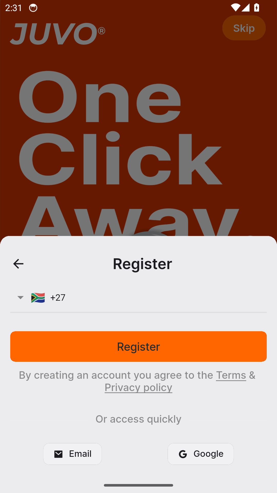

New to Juvo? Create your account in a few easy steps.

## 4. Reset your password

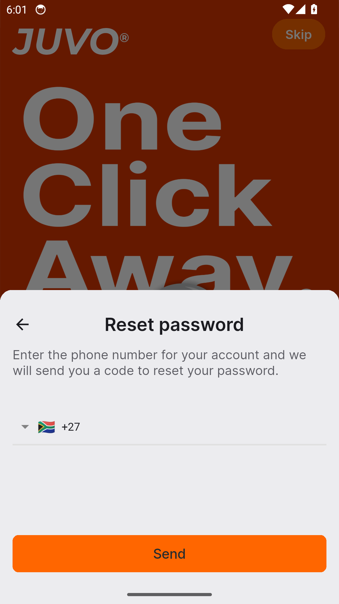

Forgot your password? Juvo gets you back in with a secure reset.

## 5. Every shop, one home

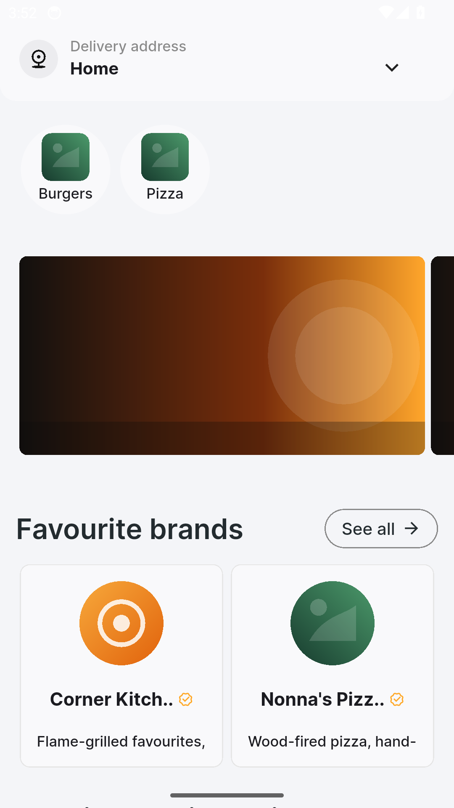

Deals, categories and every local shop on one screen.

## 6. Shop by category

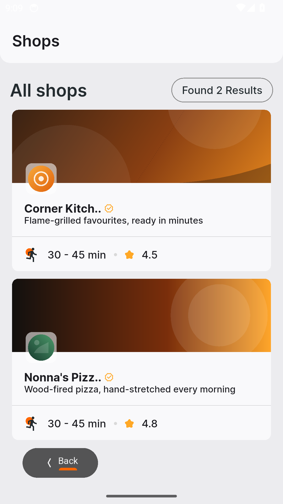

Pick a category and see just the shops that stock it.

## 7. Find it fast

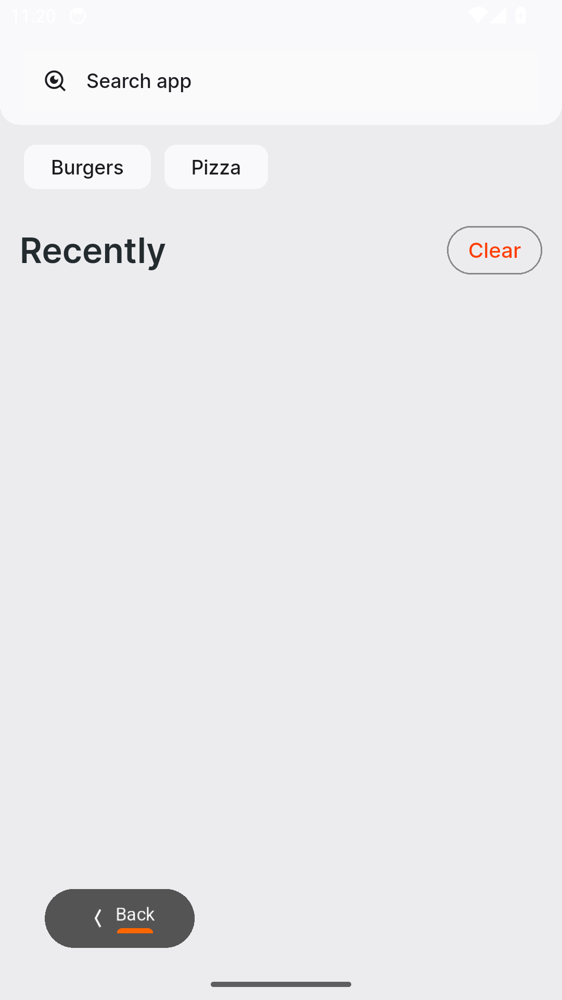

One search across shops and products, with filters a tap away.

## 8. Your favourites, kept

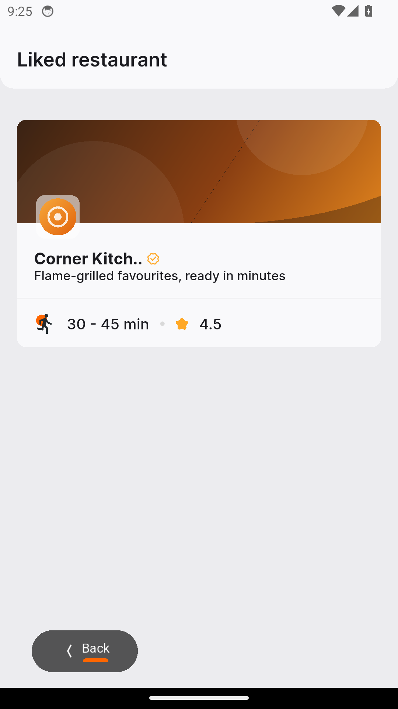

Heart a shop once and it waits for you here - your favourites, one tap away.

## 9. Make it yours

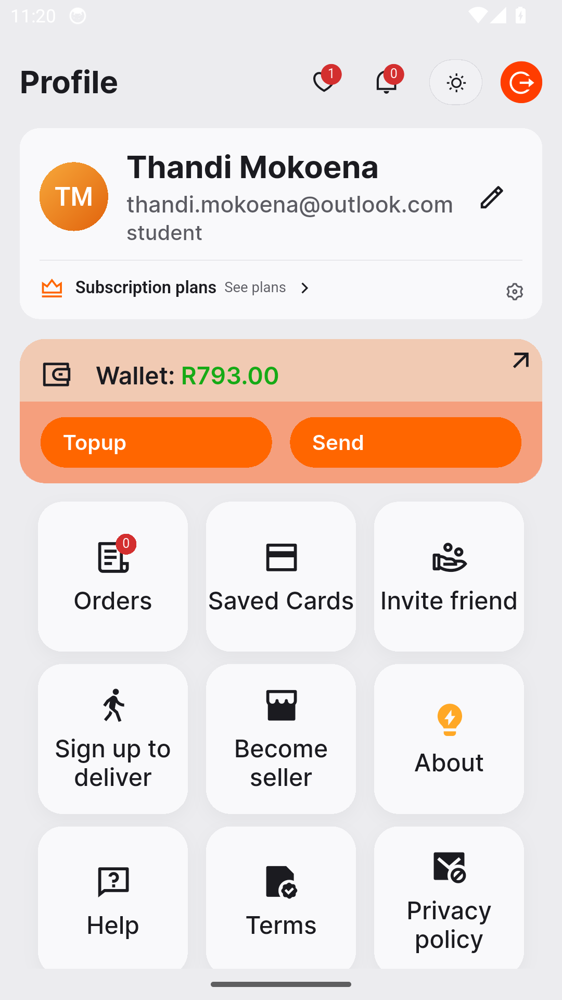

Addresses, language, currency and more - your account, set up your way.

## 10. Speak your language

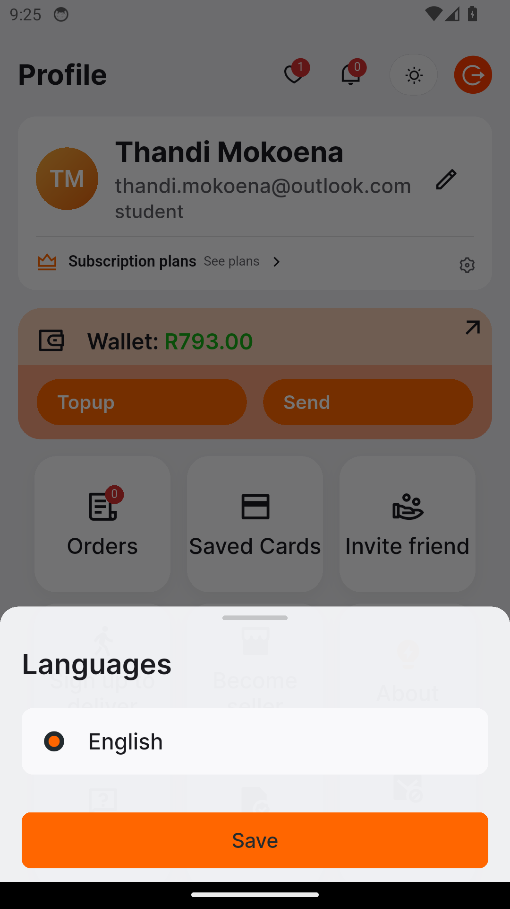

Juvo speaks your language - pick it once in the language sheet and every screen
follows.

## 11. Top up in seconds

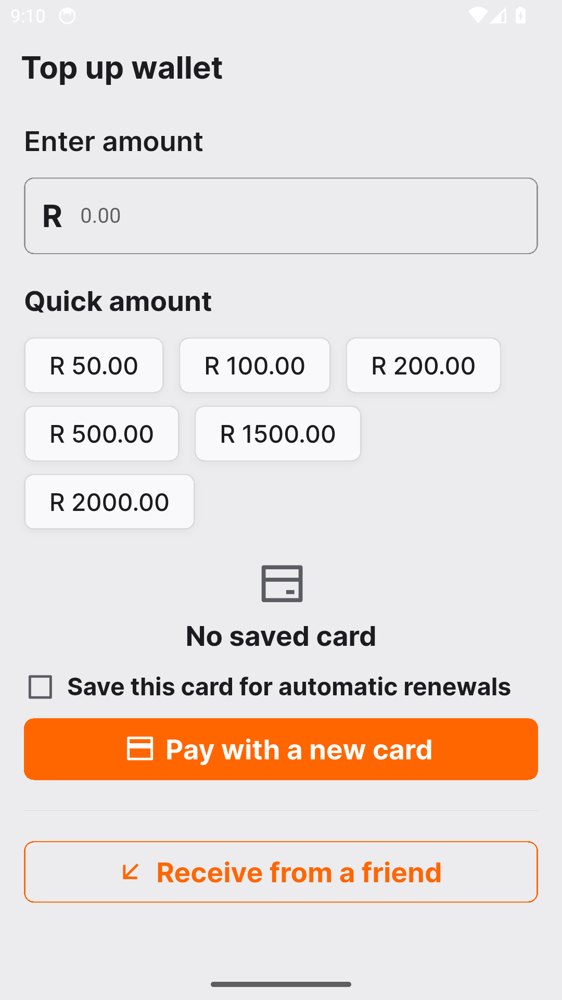

Pick an amount, pick a card, done - money in your wallet in seconds.

## 12. Every transaction, in order

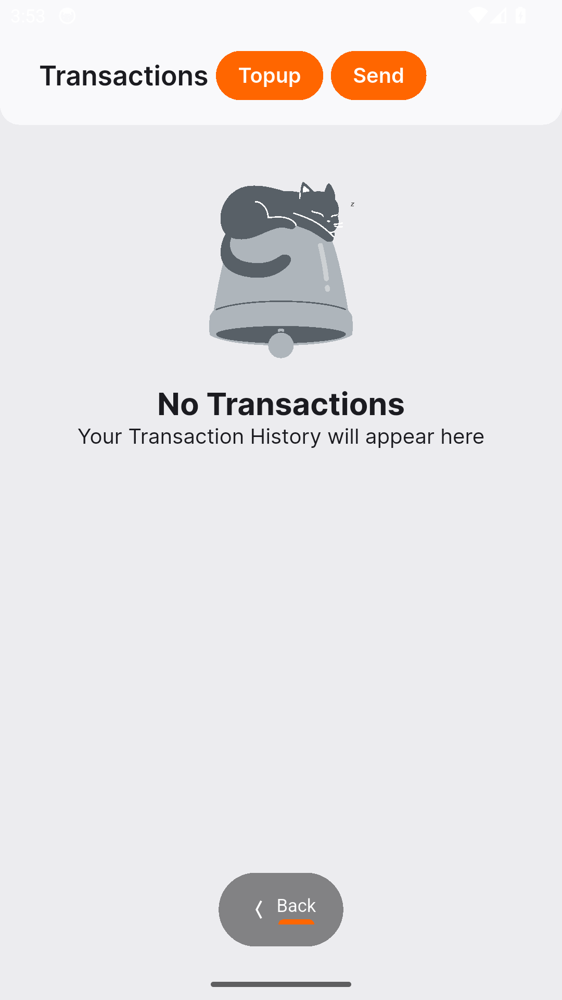

Top-ups and spend, newest first - your wallet history always adds up.

## 13. Your orders

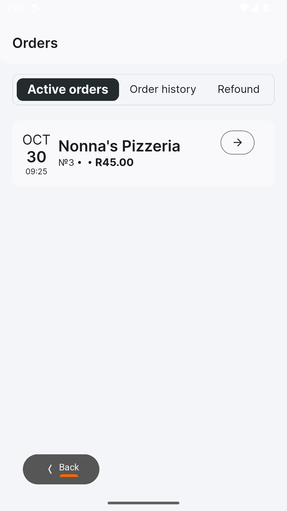

Active orders up top, the rest in your history - every order in one list.

## 14. Track it live

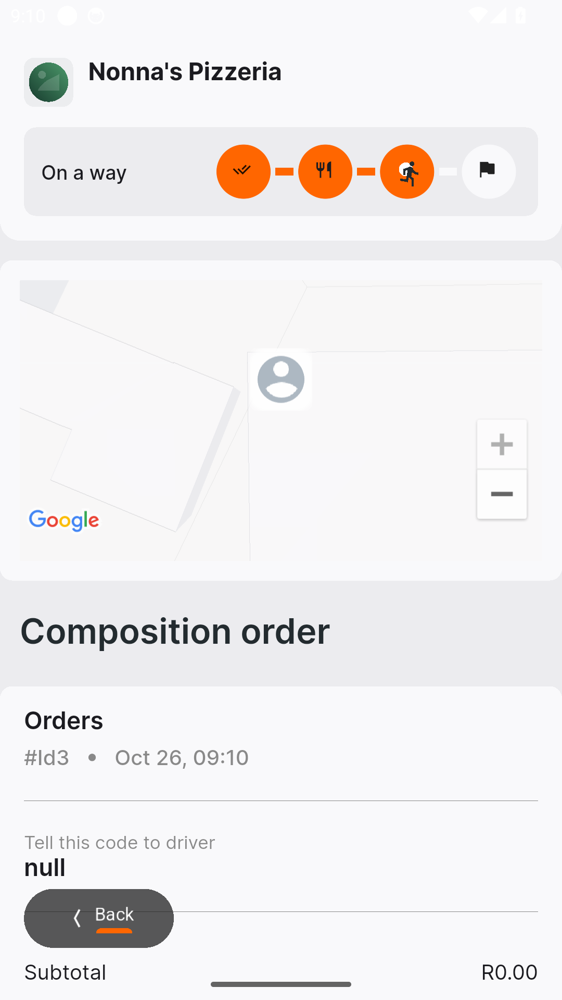

Follow the order from kitchen to door - the status updates live as it moves.
